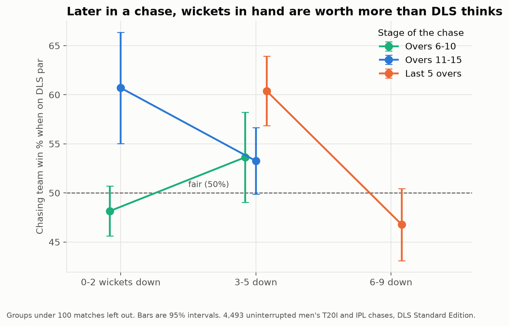
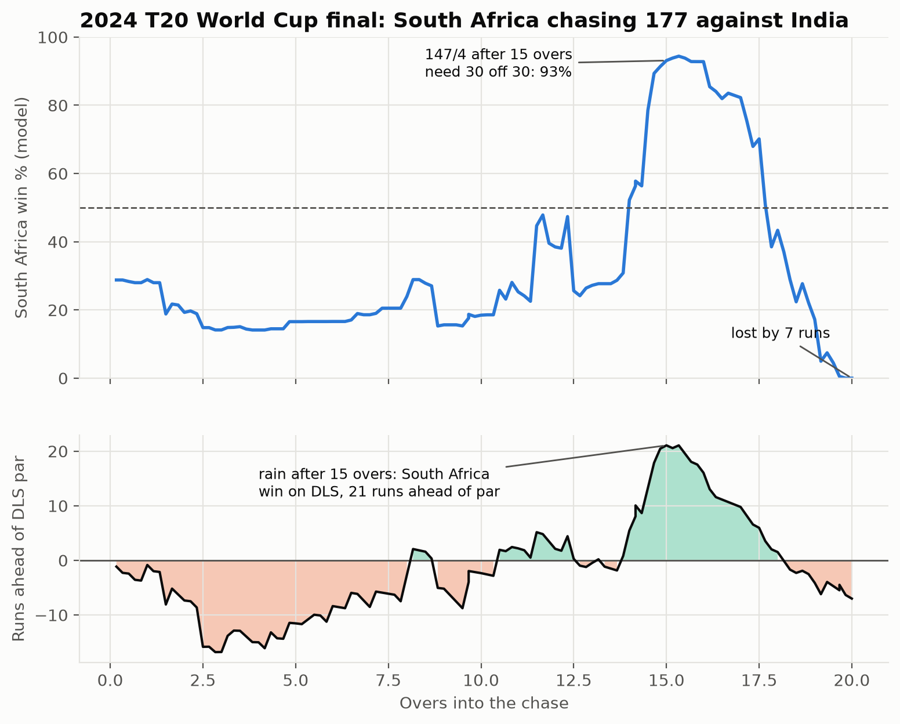

# Is DLS fair in T20 cricket?

When rain shortens a match, the Duckworth-Lewis-Stern (DLS) method sets a revised target or decides the result. A team chasing and sitting exactly on DLS par should have roughly a 50% chance of winning. DLS was designed for 50-over cricket and later applied to T20, where it is often criticised.

This project tests that claim on **4,493 uninterrupted men's T20I and IPL chases** (over 500,000 deliveries). Because these matches finished normally, their real results show what *would* have happened to a team that was on DLS par at any given moment.

**Try it:** `site/index.html` is an interactive version. Set any point in a chase to see the model's win chance, what DLS would decide if rain stopped play, and what real matches say about that call. Open the file in a browser; it needs no server.

## Key findings

1. **On average, DLS par is fair.** Teams on par went on to win 52% of the time, in line with the normal chasing advantage.
2. **But it undervalues wickets in hand, especially late in a chase.** In the last 5 overs, teams on par with 3-5 wickets down won 60%, while teams 6-9 down won 47%. In overs 11-15, teams 0-2 down on par won 61%. A fair system would put all of these at about 50%.
3. **The finding is robust.** The gap holds with different definitions of "on par", in T20Is and the IPL separately, and before and after 2019.

A likely reason: DLS was built for 50-over cricket, where wickets are saved for a long innings. In T20 there are too few balls left to use them all, so a team with wickets in hand late in a chase can attack freely, which is worth more than the 50-over table assumes.



### Example: the 2024 T20 World Cup final

South Africa were 147/4 after 15 overs, needing 30 off 30. The model gave them a 93% chance, and they were 21 runs ahead of DLS par: rain at that moment would have handed them the trophy. They lost by 7 runs.



## Approach

| Step | In this project | Notebook |
|---|---|---|
| 1. Problem definition | Given the state of a chase, predict the probability the chasing team wins (binary classification), then test whether DLS par really means 50/50 | `01` |
| 2. Data | Cricsheet ball-by-ball JSON parsed into 514k second-innings deliveries from 4,747 matches (149 DLS-affected) | `01` |
| 3. Evaluation | Log loss, Brier score and calibration, since win probabilities need to be trustworthy | `02` |
| 4. Features | Runs needed, balls left, wickets left, required run rate, competition | `02` |
| 5. Modelling | Logistic regression baseline, then gradient boosting with monotonic constraints; split by match to avoid leakage | `02`, `03` |
| 6. Experiments | Model comparison and calibration; the DLS fairness test; final figures; robustness checks | `03`-`06` |

### Notebooks

| Notebook | What it does |
|---|---|
| `01_parse_data.ipynb` | Parses Cricsheet JSON into one row per second-innings delivery, with data-cleaning decisions explained |
| `02_baseline.ipynb` | Defines success, then trains a logistic regression baseline |
| `03_model.ipynb` | Gradient boosting model, calibration, and experiments |
| `04_dls_test.ipynb` | The DLS fairness test: win rate at par by wickets lost and stage of the chase |
| `05_figures.ipynb` | Final figures |
| `06_robustness.ipynb` | Reruns the main finding under different choices, plus the 149 real DLS matches |
| `site/` | Interactive web page. `site/build/make_site.py` rebuilds it from the model and data |

### Why the main test doesn't use the model

The win probability model (gradient boosting, log loss 0.380 vs 0.694 for a naive baseline) only just beat logistic regression, and its calibration was off by up to 3.6 percentage points in places. It also gave unrealistic answers for match states that never happen in practice. So the DLS test uses **actual match outcomes** instead, and the model is only used for illustration, like the 2024 final chart.

## Limitations

- **Standard, not Professional Edition.** International matches use the proprietary DLS Professional (Stern) Edition, which was updated partly for high-scoring and shorter games. This project uses the public Standard Edition table from the ICC's DLS methodology document, so it may overstate the bias in the version actually used.
- **Termination only.** The test asks what happens if rain *ends* a chase. DLS is also used to set revised targets before or during a chase, which isn't tested.
- **Small samples at the extremes.** Situations like being on par with 9 wickets down are rare, so those estimates are uncertain. Only differences whose 95% intervals clear 50% are treated as real.
- **Missing matches.** Cricsheet withholds matches involving the Afghanistan men's team or played in the Afghanistan Premier League (166 T20Is at the time of download), so they aren't in this dataset.
- **Not fully independent.** A match can appear in more than one wicket group, so the groups aren't completely independent.

## Data

Ball-by-ball data from [Cricsheet](https://cricsheet.org/), downloaded 4 November 2026 and used under the [Open Data Commons Attribution License (ODC-By)](https://opendatacommons.org/licenses/by/1-0/).

- **Included:** `data/chases.csv`, the processed dataset every result comes from (514,444 second-innings deliveries). This lets notebooks 02-06 run without downloading anything, and pins the exact data behind the numbers in this README.
- **Not included:** the raw JSON (394MB, about 4,900 files). To rebuild `chases.csv` with notebook 01, download the men's T20 internationals and IPL zips in JSON format from [cricsheet.org/downloads](https://cricsheet.org/downloads/) and unzip into `data/t20s_male_json/` and `data/ipl_male_json/`. Cricsheet updates regularly, so a fresh download may give slightly different numbers.

The DLS Standard Edition resource table is in `reference/dls_standard_edition.csv`, taken from the ICC's DLS methodology document.

## Running it

```
python -m venv .venv
source .venv/bin/activate
pip install -r requirements.txt
```

Then run the notebooks in order. `data/chases.csv` is already included, so notebook 01 is only needed to rebuild it from the raw data. Notebook 03 saves the model to `models/`, which notebook 05 uses.
